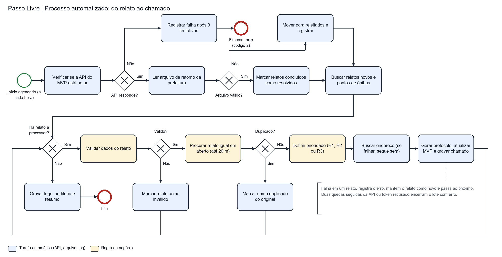

# Passo Livre: do relato ao chamado

**FIAP · Global Solution 2026.2 · CitizenTech · Engenharia de Software · 4º ano · Turma 4ESPY**
**Disciplina:** Robotic Process Automation · **Professor:** Cibele Ribeiro

## Integrantes e links

Gustavo Brisqui Martinez | 97969
Guilherme Rezende Bezerra | 98508
Matheus Brisqui Martinez | 97892

- **Vídeo demonstrativo (até 3 minutos):** 
- **Repositório:** https://github.com/matheusbrisqui/gs_rpa

Relatório técnico: [`docs/relatorio_tecnico_rpa.pdf`](docs/relatorio_tecnico_rpa.pdf)

## Ficha do produto

| Campo | |
|---|---|
| **Produto** | Passo Livre |
| **Cidadão e território** | Pessoas com deficiência, idosos e responsáveis com carrinho, em São Paulo/SP |
| **Problema** | Quem tem mobilidade reduzida relata obstáculos na calçada e no ponto de ônibus, mas o relato demora a virar chamado na prefeitura |
| **O que a automação resolve** | Triagem, priorização e encaminhamento de cada relato, e baixa automática quando a prefeitura conclui o serviço |
| **ODS** | 10 Redução das desigualdades · 11 Cidades e comunidades sustentáveis |

## O que tem neste repositório

1. **O aplicativo (MVP)**, em [`mvp/`](mvp/): mapa de obstáculos, formulário de relato, tela de acompanhamento dos chamados e painel. É onde o cidadão registra o problema e onde o resultado da automação aparece.
2. **O robô**, em [`src/passo_livre_rpa/`](src/passo_livre_rpa/): programa em Python que conversa com o aplicativo pela API e faz o trabalho que uma pessoa faria à mão.

Sem o robô, cada relato dependeria de alguém para conferir os dados, ver se já foi relatado, decidir a urgência, achar o endereço, registrar o chamado na prefeitura, anotar o protocolo e, dias depois, consultar o andamento e atualizar o aplicativo.

## O que o robô faz

A cada execução (agendada de hora em hora):

1. confere se o aplicativo está no ar (3 tentativas com espera progressiva);
2. lê o **arquivo de retorno da prefeitura** e marca como resolvidos os relatos concluídos;
3. busca os **relatos novos**, os relatos em aberto e os pontos de ônibus;
4. para **cada relato novo**: valida os dados, procura duplicado, define a prioridade, busca o endereço, gera o protocolo, **atualiza o aplicativo** e grava o chamado no lote de saída;
5. grava log, trilha de auditoria e resumo da execução.



BPMN 2.0 em [`docs/processo.bpmn`](docs/processo.bpmn) (abre no Camunda Modeler ou em https://demo.bpmn.io).

## Regras de negócio

| Regra | Condição | Resultado |
|---|---|---|
| V1, V2, V3 | tipo fora do domínio · coordenada ausente ou fora de São Paulo · data ausente ou futura | relato `invalido`, sem chamado |
| Duplicidade | relato em aberto do mesmo tipo, a até 20 m, nos últimos 30 dias (inclusive dentro do mesmo lote) | relato `duplicado` com referência ao original, sem chamado |
| R1 | perfil prioritário (pessoa com deficiência ou idosa) **e** obstáculo a até 60 m de ponto de ônibus | prioridade **alta** |
| R2 | perfil prioritário **ou** obstáculo a até 60 m de ponto de ônibus | prioridade **média** |
| R3 | demais casos | prioridade **normal** |
| Retorno `CONCLUIDO` | protocolo encontrado no aplicativo | relato `resolvido` |
| Retorno `INDEFERIDO` | | não altera; alerta para revisão humana |

## Exceções tratadas

Aplicativo fora do ar · queda no meio do lote · token recusado · recusa de um relato · arquivo de retorno ausente · arquivo inválido (vai para `entrada/rejeitados/`) · linha inválida · protocolo desconhecido · serviço de endereços fora do ar · falha ao gravar o chamado (desfaz a atualização) · execução simultânea (trava) · reexecução (não duplica).

Nenhuma falha é silenciosa. Código de saída do processo: `0` sucesso · `1` sucesso com falhas · `2` abortado · `3` já em execução.

## Integração com o MVP

O robô usa a API do aplicativo (documentação interativa em `/docs`, com o aplicativo no ar):

| Chamada | Uso |
|---|---|
| `GET /health` | verificação inicial |
| `GET /relatos?status=novo` | relatos a processar |
| `GET /relatos?status=validado` e `encaminhado` | relatos em aberto, para achar duplicados |
| `GET /relatos?protocolo=…` | localizar o relato citado no retorno da prefeitura |
| `GET /pontos` | pontos de ônibus, para a regra de prioridade |
| `PATCH /relatos/{id}` | gravar situação, prioridade, protocolo e referência ao original |

O resultado aparece nas telas, que se atualizam sozinhas a cada 5 segundos: a aba **Chamados** lista cada relato com situação, prioridade e protocolo, o **Mapa** apaga os obstáculos resolvidos e o **Painel** recalcula os indicadores. O `PATCH` exige o cabeçalho `X-Automation-Token` quando `AUTOMATION_TOKEN` está definido no `.env`.

> **Limite da demonstração:** o SP156 não tem interface pública para abertura de chamados por sistemas. O robô entrega o lote de chamados em CSV, no formato que seria enviado ao canal, e consome um CSV de retorno. Os arquivos de retorno e os relatos da demonstração são fictícios. As consultas de endereço (OpenStreetMap) são reais.

## Estrutura

```
├── src/passo_livre_rpa/     código do robô
│   ├── robo.py              orquestração das etapas
│   ├── regras.py            validação, duplicidade, prioridade, protocolo
│   ├── cliente_api.py       cliente da API do aplicativo, com novas tentativas
│   ├── retorno_prefeitura.py leitura e validação do CSV de retorno
│   ├── geocodificador.py    endereço via OpenStreetMap, com cache e disjuntor
│   ├── registro.py          log, trilha de auditoria e resumo
│   └── config.py            parâmetros por variável de ambiente
├── mvp/                     aplicativo que o robô integra
│   ├── app/                 API (FastAPI) e banco de dados
│   └── web/                 telas (HTML, CSS e JavaScript)
├── docs/                    processo.bpmn, processo.png, relatório em PDF, geradores e equipe.json
├── logs/                    amostras reais: robo_*.log, auditoria_*.jsonl, resumo_*.json
├── tests/                   testes automatizados, roteiro do cenário e evidencias/
├── assets/                  capturas de tela
├── entrada/                 onde chega o CSV de retorno (processados/ e rejeitados/)
└── saida/                   lotes de chamados gerados
```

## Como executar

Requer Python 3.11 ou mais novo. Na raiz do repositório:

```bash
python -m venv .venv
.venv\Scripts\activate            # Linux/macOS: source .venv/bin/activate
pip install -r requirements.txt
pip install -e .
```

**Terminal 1: sobe o aplicativo.** Abra http://127.0.0.1:8000 depois.

```bash
python -m uvicorn app.main:app --app-dir mvp --port 8000
```

**Terminal 2: demonstração completa.** Deixe a aba Chamados aberta para ver a mudança.

```bash
python tests/preparar_cenario.py --retorno-invalido   # cria relatos fictícios e os arquivos de retorno
python -m passo_livre_rpa                             # executa o robô uma vez
python -m passo_livre_rpa                             # de novo: nada é processado duas vezes
```

Cenário de falha, com o aplicativo fora do ar (3 tentativas, código de saída 2):

```bash
python -m passo_livre_rpa --api-url http://127.0.0.1:9
```

Execução sem intervenção humana:

```bash
python -m passo_livre_rpa --loop --intervalo 3600 --silencioso
```

ou agendada pelo sistema (Windows):

```bash
schtasks /Create /SC HOURLY /TN "PassoLivreRPA" /TR "C:\caminho\.venv\Scripts\python.exe -m passo_livre_rpa --silencioso"
```

Para proteger a alteração de relatos com token, copie `.env.example` para `.env` e defina `AUTOMATION_TOKEN`. O mesmo arquivo é lido pelo aplicativo e pelo robô. Para recomeçar a demonstração do zero, pare o aplicativo e apague o arquivo `passolivre.db`.

## Testes

```bash
python -m pytest -q
```

Cenários de **sucesso** (encaminhamento, retorno concluído, reexecução), **decisão** (três prioridades, duplicidade, inválido, indeferido) e **falha** (aplicativo fora do ar, queda no meio do lote, token recusado, arquivo inválido, endereços fora do ar, falha de gravação, execução simultânea), a verificação de que logs e arquivos de saída não contêm dados do cidadão, e os testes da API do aplicativo nos pontos de que o robô depende. Evidências das execuções reais em [`tests/evidencias/`](tests/evidencias/) e [`logs/`](logs/).

## Logs e auditoria

| Arquivo | Conteúdo |
|---|---|
| `logs/robo_AAAAMMDD.log` | uma linha por acontecimento: data e hora, nível, execução, mensagem |
| `logs/auditoria_AAAAMMDD.jsonl` | um evento JSON por item: etapa, resultado, relato, regra, protocolo |
| `logs/resumo_<execução>.json` | totais: lidos, encaminhados, duplicados, inválidos, falhas, retornos |

## Segurança e LGPD

- Token e URL em variáveis de ambiente; `.env` fora do repositório.
- O aplicativo não guarda nome nem e-mail do cidadão: o e-mail vira um código embaralhado (hash com sal).
- O perfil do cidadão (dado sensível) é usado só para calcular a prioridade. Não vai para o lote de chamados, para os logs nem para a auditoria: neles aparece apenas o código da regra.
- Logs sem descrição livre e sem identificador do cidadão, com teste automatizado que garante isso.
- Ao serviço de endereços vai apenas a coordenada do obstáculo.
- Chamado indeferido não encerra relato automaticamente: pessoa no circuito.

## Entregáveis

| Item pedido | Onde está |
|---|---|
| Código-fonte da automação | [`src/`](src/) |
| Desenho do processo (BPMN) | [`docs/processo.bpmn`](docs/processo.bpmn) e [`docs/processo.png`](docs/processo.png) |
| Logs sem dados sensíveis | [`logs/`](logs/) |
| Testes de sucesso, decisão e falha | [`tests/`](tests/) |
| Evidências e capturas de tela | [`tests/evidencias/`](tests/evidencias/) e [`assets/`](assets/) |
| Integração com o MVP | [`mvp/`](mvp/) e [`src/passo_livre_rpa/cliente_api.py`](src/passo_livre_rpa/cliente_api.py) |
| Relatório técnico | [`docs/relatorio_tecnico_rpa.pdf`](docs/relatorio_tecnico_rpa.pdf), gerado por `python docs/gerar_relatorio.py` |
